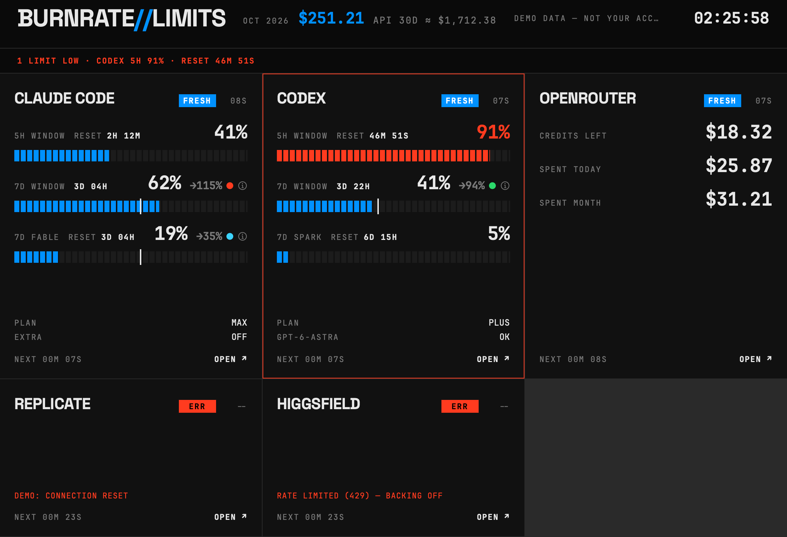
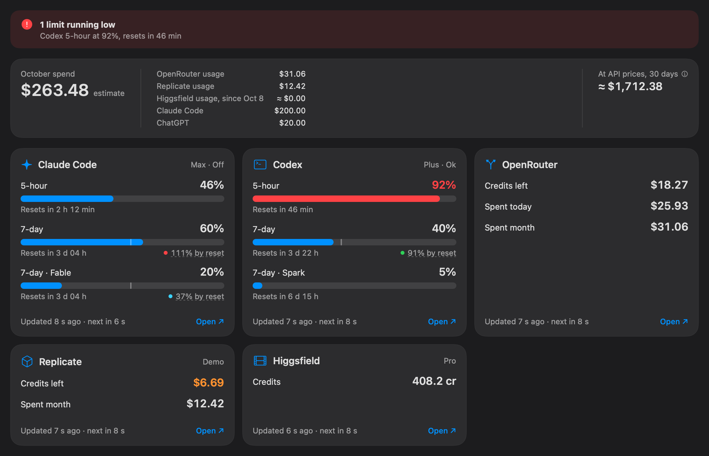
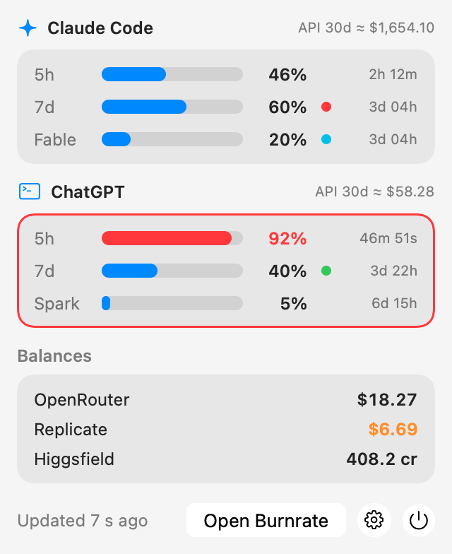
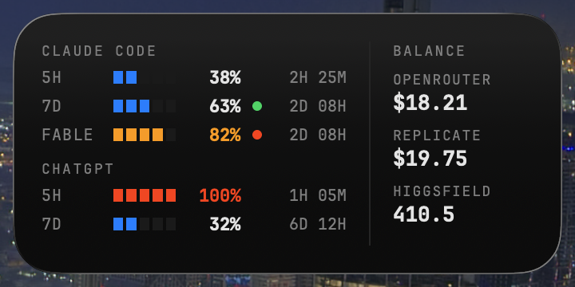
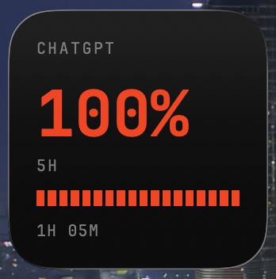

# Burnrate

[](https://github.com/Begemot34/burnrate/actions/workflows/ci.yml)
[](#install)
[](mac/Package.swift)
[](LICENSE)

<p align="center">
  
</p>

Burnrate is a macOS menu bar app, window and desktop widget that shows how much of your AI
subscriptions and prepaid balances you have burned: Claude Code and Codex rate-limit windows with a
forecast of where the week is heading, OpenRouter and Replicate credits, Higgsfield credits, the
month's spend, and what the last 30 days of Claude Code and Codex use would have cost at API prices.
Everything runs on your Mac, polling the services with the logins you already have. No server, no
account, nothing leaves the machine except the requests to those services.

<table>
  <tr>
    <td width="66%"></td>
    <td width="34%"></td>
  </tr>
  <tr>
    <td></td>
    <td></td>
  </tr>
</table>

The Boring look with its menu bar panel, and the desktop widgets (medium and small).

## Install

Needs macOS 26 and Swift 6.2: Xcode 26 or the Command Line Tools (`xcode-select --install`).

```bash
curl -fsSL https://raw.githubusercontent.com/Begemot34/burnrate/main/scripts/install.sh | bash
```

### Install with an AI agent

```text
Install Burnrate on this Mac by following https://raw.githubusercontent.com/Begemot34/burnrate/main/llms-install.md — ask me to confirm before anything that writes outside the clone or launches an app, and show me those commands first.
```

This one command builds Burnrate on your Mac, installs it into `~/Applications` with `burnratectl`
in `~/.local/bin`, and starts it. The build is ad-hoc signed and not notarized, so it runs only on
the Mac that built it.

<details>
<summary>Or install from a clone</summary>

```bash
git clone https://github.com/Begemot34/burnrate.git
cd burnrate && ./scripts/install.sh
```

Same script, same result; it builds the clone as it is, without pulling.
</details>

### Getting started

- Open Burnrate from Applications, Spotlight or `open -a Burnrate`. It lives in the menu bar;
  ⌘O opens the window.
- Claude Code and Codex need only their CLI login (`claude`, `codex login`); Higgsfield its CLI
  (`higgsfield login`).
- OpenRouter key and Replicate `sessionid` cookie: Settings ▸ Providers (⌘,). A card that is
  missing something says what on the card.
- Widget: right-click the desktop ▸ Edit Widgets ▸ Burnrate.
- `burnratectl check` polls every source once from the terminal. If the shell can't find it, add
  `~/.local/bin` to `PATH`.

### Update and uninstall

Run the install command again to update. To remove the app and `burnratectl`:

```bash
~/.local/src/burnrate/scripts/uninstall.sh            # keeps config, history and keys
~/.local/src/burnrate/scripts/uninstall.sh --purge    # removes those too
```

From a clone, use `scripts/uninstall.sh` there.

## Features

- Claude Code: 5-hour and 7-day windows, per-model weekly windows, plan and tier, extra-usage spend.
- Codex: 5-hour and 7-day windows, per-model buckets, plan, credits; falls back to the newest local
  session log when the CLI is unreachable.
- OpenRouter and Replicate: credits left, spent today and this month; Higgsfield: credits and burn.
- Pace forecast on weekly windows: the percent the window reaches at its reset at the current
  average speed (`→113%`), coloured under / on / over.
- Month total: usage plus subscriptions priced by the plan each provider reports, with
  `API 30D ≈ $X`, what this Mac's Claude Code and Codex sessions would cost per token.
- Sparkline, burn per hour and run-out per balance from local history.
- Menu bar item with the most used limit, turning orange or red and naming the source when
  something runs low; panel with every limit and balance.
- Desktop widget, small and medium, in the same look as the app.
- Two looks over the same data: **Boring** (system font, SF Symbols, Liquid Glass, light or dark) and
  **Cyberpunk** (default: black, mono, LED bars). Toolbar, View ▸ Look (⌥⌘L) or Settings (⌘,).
- Settings (⌘, or the gear in the menu bar panel): open at login, the pace forecast on or off,
  warning thresholds, and per provider on/off, refresh interval, subscription price and API keys.
- Each source polls on its own interval with jitter and backoff; 429 honours `Retry-After`; an
  expired login keeps the last values and shows what to do. Refresh All is ⌘R.

## Configuration

```bash
burnratectl init      # writes ~/.config/burnrate/config.json if missing
burnratectl check     # fetches every source once and prints a table
burnratectl dump      # one poll as JSON; -demo for fake data
burnratectl secret set OPENROUTER_API_KEY < key.txt   # a key into the Keychain; rm NAME, ls
```

`config.json` holds `history_dir`, `env_file` (default `~/.config/burnrate/.env`, a missing file is
fine), `codex_home`, `claude_home` and a `providers` map: `enabled`, `interval` (`"5m"`, `"1h30m"`),
`monthly_usd` to override a subscription price (`0` hides it), and `unofficial` for Codex, plus
`thresholds` (`warn_pct`, `crit_pct`, `warn_usd`, `crit_usd`). Settings edits the same file and keeps
keys it does not know. API keys (`OPENROUTER_API_KEY`, `REPLICATE_SESSIONID`)
live in the login Keychain under `burnrate`, entered in Settings ▸ Providers or with
`burnratectl secret set`; values in `env_file` are read too, the Keychain wins.
`burnratectl -config DIR` points at another directory.

## Widget

Right-click the desktop ▸ Edit Widgets ▸ Burnrate, small or medium. It appears once the app is in
`~/Applications` and has run once (`scripts/install.sh` registers it with `pluginkit`). The widget is
sandboxed, never touches the network, and only reads `widget.json`, which the app rewrites within
30 s of a change and at least every 5 minutes. Without the app running it keeps the last snapshot
and marks it stale after 30 minutes. Launching the bundle from a hidden directory such as a build
tree does not work; install it.

## Stack

Swift 6.2, SwiftUI, WidgetKit, Swift Testing. SwiftPM only, no Xcode project, no dependencies.
Targets: `BurnrateCore` (engine, no SwiftUI), `Burnrate` (app), `BurnrateWidget` (extension, built by
SwiftPM and packed by `mac/build-app.sh`), `burnratectl`, `BurnrateCoreTests`.

## Development

```bash
make test             # swift test --package-path mac
make lint             # swift format lint --strict
make format
make mac              # mac/dist/Burnrate.app and bin/burnratectl
make mac-run-demo     # open Burnrate.app --args -demo YES: fake data, every UI state
```

`open mac/dist/Burnrate.app --args -demo YES -snapshot /tmp/w.png` saves the window, the menu panel
and the menu icon as PNGs after 8 s; `-look boring|cyberpunk` and `-snapshotScheme light|dark`
pick the look for that launch. Snapshot and demo runs exit at once if another Burnrate with the same
bundle id is running, so quit the installed app first. `BUNDLE_ID=com.you.burnrate make mac` changes the bundle id.
Agent notes are in [AGENTS.md](AGENTS.md), decisions in [docs/adr](docs/adr).

## Where the data comes from

Burnrate only reads what is already on your Mac and talks only to the service that issued each
credential. No telemetry, nothing is sent anywhere else.

- **Claude Code**: the OAuth token Claude Code keeps in the Keychain (`Claude Code-credentials`),
  sent to `api.anthropic.com/api/oauth/usage` (undocumented).
- **Codex**: asks `codex app-server` over JSON-RPC; the token stays inside Codex. Opt-in
  `"unofficial": true` reads `~/.codex/auth.json` for `chatgpt.com/backend-api/wham/usage`
  (undocumented); without either, the newest local session log.
- **OpenRouter**: your API key from the Keychain against its public API.
- **Replicate**: its API has no billing, so account, credit and monthly spend come from the website
  with the `REPLICATE_SESSIONID` web cookie (undocumented); no API token is needed.
- **Higgsfield**: `higgsfield account status --json`.
- **API-price estimate**: token counts from local Claude Code and Codex session logs, priced by
  OpenRouter's public model list (fetched once a day).

**Subscriptions.** The plan is not guessed: Claude Code reports it with the token
(`subscriptionType`, `rateLimitTier`), Codex with its rate limits (`plan_type`), Higgsfield in its
status. The month total prices known plans from a built-in table (Claude Pro $20, Max 5x $100,
Max 20x $200, ChatGPT Plus $20, Pro $200); set `providers.<name>.monthly_usd` in `config.json` to
override it or to add a plan the table does not know.

Tokens are never refreshed or stored by Burnrate, and token-shaped strings are cut out of errors.
Undocumented endpoints can break without notice; the card then shows an error and keeps the last
good values. History lives in `~/Library/Application Support/burnrate/`.

## License

MIT, © 2026 Konstantin Kozhanov. The Cyberpunk look bundles
[Space Grotesk](https://github.com/floriankarsten/space-grotesk) and
[JetBrains Mono](https://github.com/JetBrains/JetBrainsMono), both SIL OFL 1.1, stored in `mac/Resources/Fonts/` with their licenses;
see [THIRD_PARTY_NOTICES.md](THIRD_PARTY_NOTICES.md).
